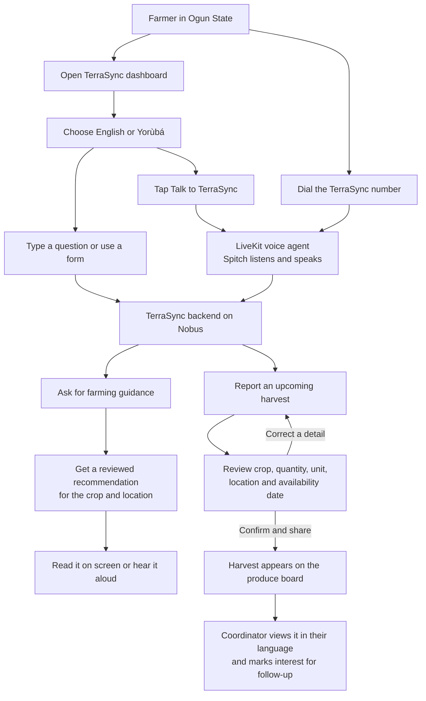

Yes. I’d update the TerraSync plan so farmers can use the dashboard in English or Yoruba, type a question, or tap “Talk to TerraSync” and speak. Farmers with a basic phone can reach the same assistant by dialling in once phone routing is connected.

For example, a farmer selects Yorùbá and opens their maize crop on the dashboard. They tap the microphone and ask, “What should I prepare before harvest?” The assistant already knows which crop they’re viewing, so it can read the relevant guidance aloud and show it on screen. If the farmer then says, “I’ll have 20 bags ready next Friday,” TerraSync shows the crop, quantity, location and exact date for correction or confirmation. After confirmation, the report appears on the coordinator’s produce board.

I’d build it in three parts:
- Dashboard language. Add an English / Yorùbá switch and remember the choice. Translate the navigation, forms, guidance cards, dates and confirmation messages. Store each harvest report once so a farmer and coordinator can view the same record in different languages.
- Voice chat inside the dashboard. Put a Talk to TerraSync button on the farmer’s home and crop screens. LiveKit connects the browser microphone to the assistant. Spitch handles speech recognition and spoken replies. Default to the dashboard language, with an option to change the spoken language. Show the transcript so the farmer can catch a misheard quantity or place name. LiveKit’s Spitch speech recognition guide · Spitch voice generation guide
- One backend for voice and touch. The form, browser assistant and phone assistant should all use the same functions to look up guidance and save a confirmed harvest report. The browser can use the signed-in farmer’s selected crop. On a phone call, the assistant asks for the crop and location when it doesn’t have that context.
For the hackathon, I’d make the bilingual dashboard and in-app voice chat the primary demo. Show a farmer switching to Yoruba, asking a question, correcting a harvest quantity by voice, and seeing the confirmed report appear on the coordinator’s English dashboard. That demonstrates language access, farming guidance and supply-chain coordination in one journey. The LiveKit Builder agent exists, but the Spitch integration, bilingual screens and end-to-end flow still need implementation and testing with a fluent Yoruba speaker.

    
11:42 AM

okay draw the plan

11:42 AM

TerraSync hackathon plan — from a farmer’s question to a coordinator’s follow-up

What we build, in order
Milestone	What the team delivers	How we test it
1. Bilingual dashboard	Farmer and coordinator views on Nobus, with an English / Yorùbá switch. Start with maize in Odeda as the demo scenario.	A farmer enters 20 bags in Yoruba. A coordinator sees the same report in English, with the quantity and unit intact.
2. Farming guidance	A small set of reviewed maize guidance cards with sources. The dashboard uses the farmer’s selected crop and location to find an applicable card.	The farmer asks what to prepare before harvest and receives a relevant action. If there’s no matching card, TerraSync says so.
3. In-app voice chat	Connect the dashboard microphone to LiveKit and Spitch. The assistant can retrieve guidance and draft a harvest report through the same backend as the forms.	A Yoruba speaker corrects “12 bags” to “20 bags.” The assistant reads back 20 bags, and the board updates only after confirmation.
4. Phone dial-in	Connect the phone number to the voice agent. A caller can choose a language, hear guidance and report produce from a basic phone.	A real inbound call produces one confirmed report that the coordinator can act on.

Current starting point: The LiveKit Builder agent exists. At the last check, the project’s US number had no inbound routing. The bilingual dashboard, Spitch integration, Nobus deployment and end-to-end call still need to be built or verified.

Finish line for the demo: A farmer speaks Yoruba, gets a useful answer, confirms an upcoming harvest, and watches a coordinator register interest from the English dashboard.